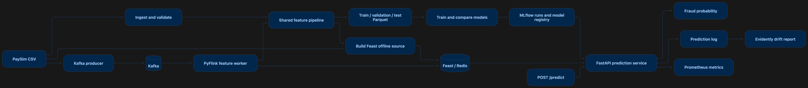
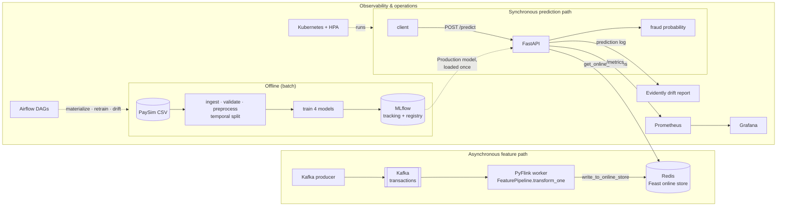

<div align="center">

# Real-Time Fraud Detection MLOps Platform

**An end-to-end MLOps system for fraud detection: from raw data and experiment tracking, through live Kafka → Flink → Feast features, to a FastAPI scoring service with monitoring, scheduling and Kubernetes deployment.**

[](https://github.com/satyazm/Fraud-Detection-using-MLOps/actions/workflows/ci.yml)


</div>

---

## Overview

Built on the [PaySim](https://www.kaggle.com/datasets/ealaxi/paysim1) synthetic mobile-money dataset (**6,362,620 transactions, 0.13% fraud**), this project is a hands-on reference for how the pieces of a production ML system fit together — not just a model, but everything around it:

- **Train & track** four models with MLflow, handle the extreme class imbalance, and register the best one.
- **Stream** transactions through Kafka and compute features with a real PyFlink job into a Feast/Redis online store.
- **Serve** fraud probabilities from a FastAPI service that reads precomputed online features and the MLflow *Production* model.
- **Observe** it with Prometheus, Grafana and Evidently AI drift reports.
- **Operate** it with Docker, Kubernetes (HPA + Ingress), Airflow DAGs and GitHub Actions CI.

One design rule runs through the whole codebase: **there is exactly one implementation of every feature**, shared by offline training, the streaming job and the API, so training/serving skew cannot creep in ([ADR-0003](docs/decisions/0003-shared-feature-pipeline.md)).

## Architecture



Two paths meet in Redis — an **asynchronous feature path** and a **synchronous prediction path**:



> If a transaction's features are not in Redis yet, `/predict` returns **503** rather than silently recomputing them — features are computed once, in the stream.

## Results

Model comparison on the full dataset with a **chronological split** (train on the earliest `step`s, validate on the next, test on the latest — see the [training guide](docs/guides/training-and-mlflow.md)). Generated by `make train` → [docs/model_report.md](docs/model_report.md).

| Model | PR-AUC (val) | ROC-AUC (val) | Precision (val) | Recall (val) |
|---|---|---|---|---|
| Logistic Regression | 0.9184 | 0.9999 | 0.0874 | 1.0000 |
| Random Forest | 1.0000 | 1.0000 | 1.0000 | 1.0000 |
| XGBoost | 1.0000 | 1.0000 | 1.0000 | 1.0000 |
| LightGBM | 0.9940 | 1.0000 | 0.9912 | 1.0000 |

The registered model (Random Forest — it ties XGBoost on validation) scores test PR-AUC 1.0000 with TP=3998, FP=0, FN=8, TN=914,611.

**Read these numbers with care.** PR-AUC, not accuracy, is the selection metric (a model that never predicts fraud is 99.87% "accurate"). But PaySim is synthetic and its fraud has an easy tell — in the XGBoost model, two balance-consistency features carry ~92% of the importance — so near-perfect scores do **not** imply real-world performance. See [Known limitations](#known-limitations).

## Quickstart

**Prerequisites:** Python 3.11, Docker + Docker Compose, a JDK (11/17/21) for PyFlink, and the PaySim CSV from [Kaggle](https://www.kaggle.com/datasets/ealaxi/paysim1) placed at `data/raw/PS_20174660362_1_log.csv`.

```bash
# 1. Install (the Makefile handles PyFlink's setuptools<81 / --no-build-isolation quirk)
python3.11 -m venv .venv && source .venv/bin/activate
make install-dev

# 2. Prepare data and train (logs to MLflow, registers the best model)
make preprocess
make train

# 3. Start the real-time feature platform
make infra-up && make flink-jar
make feast-apply && make materialize
make flink-worker                      # terminal 1: Kafka -> features -> Redis

# 4. Promote the model to "Production", then serve it
python - <<'PY'
from mlflow.tracking import MlflowClient
MlflowClient().transition_model_version_stage(
    name="fraud-detection-classifier", version=1, stage="Production")
PY
make api                               # terminal 2: http://localhost:8000/docs

# 5. Score a transaction
curl -X POST localhost:8000/predict -H "Content-Type: application/json" -d '{
  "step": 1, "type": "TRANSFER", "amount": 181.0, "nameOrig": "C1231006815",
  "oldbalanceOrg": 181.0, "newbalanceOrig": 0.0, "nameDest": "C1666544295",
  "oldbalanceDest": 0.0, "newbalanceDest": 0.0
}'
```

Run `make help` for every task. Detailed walkthroughs are in the [guides](#documentation).

## Features

| Area | What's implemented |
|---|---|
| **Data** | Ingestion, schema validation, quality report with plots, one-hot preprocessing, chronological train/val/test split |
| **Features** | Nine stateless engineered features in one shared `FeaturePipeline`, a feature registry with a version hash, deterministic Feast entity keys |
| **Training** | LR / Random Forest / XGBoost / LightGBM, class weighting for the 0.13% fraud rate, PR-AUC-based selection, MLflow tracking and Model Registry |
| **Streaming** | Kafka (KRaft) producer/consumer, real PyFlink job writing to Feast/Redis, per-record fault isolation |
| **Serving** | FastAPI `/predict`, `/health`, `/ready`, `/metrics`; model loaded once from the *Production* stage; 503 when features are missing |
| **Observability** | Prometheus metrics, auto-provisioned Grafana dashboard, `redis-exporter`, `cAdvisor`, Evidently data-drift reports from a real prediction log |
| **Operations** | Three Dockerfiles, Docker Compose stack, Kubernetes manifests (HPA 2–10 replicas, Ingress, PVCs, Secrets), three Airflow DAGs |
| **Quality** | 135 tests, ruff + black + mypy, pre-commit, GitHub Actions CI (lint/test, image builds, `kubeconform`, DAG import checks) |
| **Demo** | Streamlit dashboard that streams real rows through the live pipeline and shows live precision/recall against the ground-truth label |

## Project structure

```text
.
├── src/fraud_detection/        # Installable package (clean-architecture layers)
│   ├── domain/                 #   entities & schemas — depends on nothing else
│   ├── common/                 #   config loading, structured logging
│   ├── data/                   #   ingestion, validation, preprocessing, split
│   ├── features/               #   shared feature pipeline + Feast integration
│   ├── models/                 #   training, evaluation, MLflow registry
│   ├── streaming/              #   Kafka producer/consumer, PyFlink job
│   ├── api/                    #   FastAPI inference service
│   ├── monitoring/             #   Prometheus metrics, prediction log, drift
│   └── cli.py                  #   `fraud-detection` entry point
├── tests/                      # pytest suite mirroring src/
├── configs/                    # base.yaml + dev/prod overlays, logging.yaml
├── feast_repo/                 # Feast entity + feature view definitions
├── data/                       # raw/processed data (gitignored), wire-format contract
├── docker/                     # Dockerfiles, Prometheus & Grafana provisioning
├── docker-compose.yml          # Local stack: Kafka, Redis, MLflow, API, monitoring
├── kubernetes/                 # kind-cluster manifests (see ADR-0009)
├── airflow/                    # Airflow stack + three DAGs
├── dashboard/                  # Streamlit live demo
├── docs/                       # architecture, ADRs, guides, generated reports
├── requirements/               # pinned base / dev / prod dependencies
└── .github/                    # CI workflow, issue & PR templates
```

## Documentation

| Document | What's inside |
|---|---|
| [Architecture](docs/architecture.md) | Layering rules, dependency direction, end-to-end flow |
| [Decision records](docs/decisions/) | Nine ADRs explaining *why*, including the real bugs found running everything |
| [Getting started](docs/guides/getting-started.md) | Requirements, setup, every `make` task, configuration, logging |
| [Training & MLflow](docs/guides/training-and-mlflow.md) | Models, imbalance handling, split, tracking, registry |
| [Streaming & features](docs/guides/streaming-and-features.md) | Kafka, PyFlink, Feast + Redis |
| [Inference API](docs/guides/inference-api.md) | Endpoints, model promotion, local and Docker runs |
| [Observability](docs/guides/observability.md) | Prometheus, Grafana, Evidently drift |
| [Kubernetes](docs/guides/kubernetes.md) | `kind` setup, deployment, ingress, HPA |
| [Airflow & dashboard](docs/guides/airflow-and-dashboard.md) | DAGs, schedules, the Streamlit demo |
| [Data report](docs/data_report.md) · [Model report](docs/model_report.md) | Generated by `make validate` / `make train` |

## Roadmap

| Milestone | Status | Scope |
|---|---|---|
| 1 | ✅ Done | Foundation, configuration, logging, domain layer |
| 2 | ✅ Done | PaySim ingestion, validation, preprocessing, EDA |
| 3 | ✅ Done | Shared features, model comparison, MLflow tracking and registry |
| 4 | ✅ Done | Kafka producer/consumer and shared transaction contract |
| 5 | ✅ Done | PyFlink + Feast + Redis real-time feature pipeline |
| 6 | ✅ Done | FastAPI inference using Feast features and a Production-stage model |
| 7 | ✅ Done | Prometheus, Grafana and Evidently drift reporting |
| 8 | ✅ Done | Kubernetes deployment, Airflow DAGs, expanded CI |

## Known limitations

Documented openly rather than hidden — each one is a candidate next step:

- **Synthetic data, near-perfect scores.** PaySim's fraud is mechanically easy to spot; results will not transfer to real bank data.
- **Stateless features.** Every feature is computed from a single transaction. There are no account-history, velocity or rolling-window features, which is where most real fraud signal lives.
- **Flink runs in local-execution mode** at parallelism 1, with no event time, windows, keyed state or checkpointing ([ADR-0006](docs/decisions/0006-feast-redis-flink.md)).
- **No ground-truth feedback loop in production monitoring.** Live precision/recall is only computed in the Streamlit demo; Prometheus/Grafana track input and prediction distributions ([ADR-0008](docs/decisions/0008-monitoring.md)).
- **CI only, no automated CD.** Images are built but not pushed, and deployment to the local `kind` cluster is a manual `kubectl apply`.
- **Stress testing is not done** — HPA scale-up under load has not been demonstrated ([ADR-0009](docs/decisions/0009-deployment-and-operations.md)).
- **Airflow and Kubernetes training use a 38,213-row sample** (all fraud + 30,000 legitimate rows), because the full file exhausts the local Docker VM.
- **Local-only deployment**: single-node Kafka/Redis, no auth on the API, default dev passwords in compose files.

## Contributing

Issues and pull requests are welcome — see [CONTRIBUTING.md](CONTRIBUTING.md). The short version: `make install-dev`, then `make lint typecheck test` before pushing.

## License

Released under the [MIT License](LICENSE).
