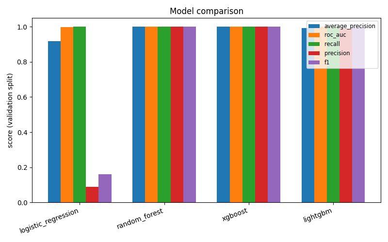

# Model Comparison Report

_Generated by `fraud-detection train`. Do not edit by hand — rerun the command instead._

## Overview

- Feature version: `d6bdfb2a6697`
- Git commit: `3107ff2792c66a2ab826018ded7bc49f72133480`
- Best model (by validation average_precision): **random_forest**
- Registered as: `fraud-detection-classifier` version `3`

Model selection uses **validation** `average_precision` (PR-AUC), not `accuracy` — with ~0.13% fraud, a model that always predicts "not fraud" would score ~99.87% accuracy while catching zero fraud. PR-AUC is not inflated by the large number of easy true negatives the way accuracy and ROC-AUC can be.

## Validation metrics

| model | average_precision | roc_auc | precision | recall | f1 | accuracy |
|---|---|---|---|---|---|---|
| logistic_regression | 0.9184 | 0.9999 | 0.0874 | 1.0000 | 0.1608 | 0.9940 |
| random_forest **←best** | 1.0000 | 1.0000 | 1.0000 | 1.0000 | 1.0000 | 1.0000 |
| xgboost | 1.0000 | 1.0000 | 1.0000 | 1.0000 | 1.0000 | 1.0000 |
| lightgbm | 0.9940 | 1.0000 | 0.9912 | 1.0000 | 0.9956 | 1.0000 |

## Test metrics (best model only, unused for selection)

| model | average_precision | roc_auc | precision | recall | f1 | accuracy |
|---|---|---|---|---|---|---|
| random_forest | 1.0000 | 1.0000 | 1.0000 | 0.9980 | 0.9990 | 1.0000 |

Confusion matrix (test): TP=3998, FP=0, FN=8, TN=914611

## MLflow runs

| model | run_id |
|---|---|
| logistic_regression | `cc5e9fcff0ed486ca3c3694c445d9a02` |
| random_forest | `6302be008fce41fdab241a2335bfb570` |
| xgboost | `ae656ec66c5c4c18821aa2bb9be51b6e` |
| lightgbm | `802ce0a5c72f4a1cbde071a54ca57a45` |

## Plots

